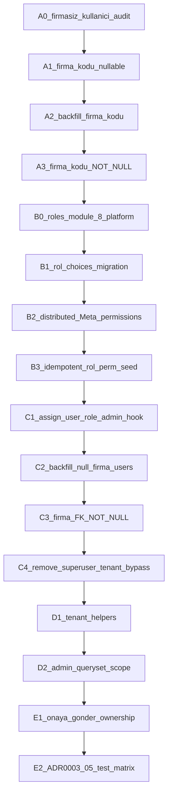

# Faz 1 — Kimlik / RBAC / tenant: veri modeli ve geçiş stratejisi

**Durum:** Tasarım kesinleştirildi (ADR-0003) — **kod yok**  
**Tarih:** 2026-11-08  
**Bağlayıcı ADR:** [`ADR-0003`](../decisions/ADR-0003-faz1-kimlik-rbac.md) (kimlik/RBAC) · [`ADR-0004`](../decisions/ADR-0004-modular-python-organizasyon.md) (dosya organizasyonu)  
**Son teknik inceleme:** [`faz1-teknik-inceleme.md`](faz1-teknik-inceleme.md)  
**Kaynak:** rapor §5.1, §7, §9.1, K-002…K-005; Faz 0 tenant denetimi  

Ayrı kullanıcı onayı olmadan model, migration, service veya admin koduna dokunulmaz.

**Kapsam dışı:** katalog/teklif ayrımı (Faz 2–3), DRF API (Faz 7), stok/sipariş, onay workflow’unun baştan tasarımı.

---

## 1. Bitiş kriteri (Acceptance)

Hepsi ADR-0003 ile sabit; testler çalıştırılmadan Faz 1 bitmez.

1. Her kullanıcının `firma` alanı **NOT NULL** (DB + uygulama); superuser dahil.
2. Kanonik **8 platform rolü**; alıcı/tedarikçi rolleri ayrı küme; tek rol / kullanıcı.
3. Rol kodları tek sabitte; Group `rol:<kod>`; permission’lar ilgili app modellerinde; merkezi idempotent seed.
4. `assign_user_role` tek yazma yolu; admin aynı yolu kullanır.
5. `is_superuser` tenant’ı otomatik aşmaz; platform işlemleri açık permission + audit.
6. Tenant helpers + admin queryset scope (platform izinli ayrık).
7. **K-004:** `onaya_gonder` sahiplik + yetki + IDOR engeli (+ kritik audit).
8. ADR-0003-05’teki **tüm** izolasyon senaryoları yeşil (Admin, servis, ilişkili nesne, firma yöneticisi ≠ platform, superuser politikası).

---

## 2. Hedef veri modeli

### 2.1 `Firma`

| Alan | Mevcut | Hedef | Not |
|------|--------|-------|-----|
| Kimlik / iletişim / bayraklar | Var | Koru | `alici_mi` / `tedarikci_mi` / `platform_mu` |
| `tek_platform_firmasi` | Var | Koru | |
| `firma_kodu` | Yok | Unique, değişmez, NOT NULL (backfill sonrası) | Platform firma sabit kod (örn. `PLATFORM`) |
| `firma_tipi` enum | Yok | Faz 1’de **yapılmaz** | Bayraklar kalır |

Pasif firma (`aktif=False`): giriş/ops engeli servis/auth katmanında (uygulama adımında).

### 2.2 `Kullanici` (ADR-0003-02)

| Kural | Hedef |
|-------|--------|
| `firma` | Geçiş sonrası **NOT NULL**; her kullanıcı (superuser dahil) bir firmaya bağlı |
| `rol` | Tek aktif iş rolü; choices = 8 platform + mevcut alıcı + tedarikçi seti |
| Platform seti | `platform_super`, `platform_admin`, `platform_ops`, `platform_finance`, `platform_catalog`, `platform_quality`, `platform_logistics`, `platform_support` |
| Eşleme | Mevcut 3 platform rolü birebir kanonikte (silme yok) |
| Rol↔firma tipi | Platform rolü → yalnızca `platform_mu`; alıcı/tedarikçi aynı |
| `is_superuser` | Teknik bayrak; firma zorunlu; iş yetkisi yerine geçmez |

**Çoklu rol:** Varsayılan yok. Gerekirse ayrı ADR.

### 2.3 Rol sabitleri (ADR-0003-01)

```text
firmalar/roles.py  (veya eşdeğeri — tek kaynak)
  PLATFORM_ROLES = (...)
  ALICI_ROLES = (...)
  TEDARIKCI_ROLES = (...)
  ALL_ROLES = ...
  role_group_name(code) -> "rol:<code>"
```

Model `choices`, admin, seed ve testler bu sabitten okur. String dağılmaz.

Platform admin permission seti ≠ `alici_yonetici` / `tedarikci_yonetici`.

### 2.4 Permission modeli (ADR-0003-04)

```text
Model.Meta.permissions (app’e göre dağıtık)
        ↑
idempotent merkezi seed (rol → permission listesi)
        ↑
Group(name="rol:<kod>")  ← sync ← assign_user_role
```

| Konu | Model / app |
|------|-------------|
| Firma | `firmalar.Firma` |
| Kullanıcı | `firmalar.Kullanici` |
| Ürün / onay submit | `urunler.Urun` |
| Teklif / fiyat (Faz 1’de ihtiyaç kadar) | `fiyatlama.*` |
| Sipariş | Sonraki faz |

Runtime: `user.has_perm("urunler.<codename>")` veya ince `YetkiServisi.require(...)` — **rol string switch yok**.

### 2.5 Tenant scope sözleşmesi

Şemaya zorunlu `tenant_id` eklenmez. Explicit helper’lar:

```text
resolve_actor(user) -> Actor(firma_id, is_platform_firm, permissions…)
scope_queryset(qs, actor, *, firma_field=...)
assert_object_firma(actor, obj_firma_id)  # fail → 404/deny
require_perm(actor, codename)
```

- Platform genel erişim: açık permission (+ audit); `is_superuser` sessiz bypass değil.
- Admin: firma kullanıcısı yalnız kendi firma scope’u; platform personeli permission’ına göre.
- Client’tan gelen `firma_id` güvenilmez (API gelince aynı helper).

### 2.6 K-004 sahiplik (ADR-0003-03) — şema değişmez

`onaya_gonder(urun, kullanici)`:

1. `kullanici.firma_id` zorunlu (NOT NULL politikası).
2. `urun.tedarikci_id == kullanici.firma_id` (sahip firma).
3. Gerekli permission/rol (örn. tedarikçi katalog submit).
4. Aksi → ValidationError / deny; IDOR ile B firması ürünü gönderilemez.
5. Kritik başarı/başarısızlık audit (minimum: kim, hangi urun_id, sonuç, neden).

**Dahil değil:** onay durum makinesinin yeniden tasarımı, kanal/yayın kurallarının refaktörü.

---

## 3. Geçiş stratejisi

Production migrate yok. Her adım ayrı onaylanabilir birim; kod ancak genel “Faz 1 uygula” talimatıyla.



| Adım | Ne | Migration? | Risk |
|------|-----|------------|------|
| A0 | `firma_id IS NULL` envanter | Hayır | Düşük |
| A1–A3 | `firma_kodu` additive → backfill → NOT NULL unique | Evet | Orta |
| B0–B1 | 8 platform rol sabiti + choices | Evet (AlterField) | Düşük — mevcut 3 kod kalır |
| B2–B3 | Dağıtık `Meta.permissions` + idempotent seed | Evet / command | Orta |
| C1 | Admin → `assign_user_role` | Hayır | Düşük |
| C2 | NULL firma backfill (platform → Platform firması) | Data | **Yüksek** — doğrulanmadan C3 yok |
| C3 | `firma` NOT NULL | Evet | Yüksek — kapı: sıfır NULL |
| C4 | Servis/admin’den superuser tenant bypass kaldırma; audit | Hayır | Yüksek — testler önce güncellenir |
| D1–D2 | Scope helpers + admin | Hayır | Orta |
| E1 | K-004 sahiplik | Hayır | Orta |
| E2 | ADR-0003-05 matrisi | Hayır | — |

### C2 / C3 kapı kontrolü (ADR-0003-02)

```text
1. Firmasız kullanıcı listesi boş değilse → dur, backfill
2. Platform personeli → Kuyumbank Platform firması
3. Diğerleri doğrulanmış firmaya
4. COUNT(firma_id IS NULL) == 0
5. Sonra NOT NULL migration
```

Superuser firmasız bırakılmaz.

### C4 sırası

1. Testleri platform firma + kanonik rol ile yaz (firmasız superuser yok).
2. `platform_kullanicisi_mi` ve benzeri `is_superuser` kısa yollarını kaldır / audit’li break-glass’a indir.
3. `Kullanici.save` firmasız superuser muafiyetini kaldır (NOT NULL ile uyum).

---

## 4. Zorunlu test matrisi (ADR-0003-05 + K-004)

| # | Senaryo | Yüzey |
|---|---------|--------|
| T1 | Firma A, Firma B kaydını listeleyemez | Admin queryset + scope helper |
| T2 | Firma A, Firma B kaydını ID ile getiremez | Servis / admin object |
| T3 | Firma A, Firma B kaydını değiştiremez / silemez | Servis / admin |
| T4 | Firma A, B’nin ilişkili nesnesi üzerinden işlem yapamaz | Örn. adres, ürün alt nesnesi, `onaya_gonder` |
| T5 | Firma yöneticisi platform permission kullanamaz | `has_perm` / YetkiServisi |
| T6 | Platform kullanıcısı yalnız tanımlı platform izinleri | RBAC seed |
| T7 | Superuser: firma zorunlu; sessiz tenant bypass yok | Model + servis |
| T8 | `onaya_gonder` başka tedarikçi ürününde fail | `onay_servisi` |
| T9 | `onaya_gonder` yetkisiz rol fail | permission |
| T10 | İkinci platform firması DB reject | constraint |
| T11 | `assign_user_role` + admin save Group eşitliği | firmalar |
| T12 | Seed iki kez → permission/group çoğalmaz | idempotent |

Hepsi PostgreSQL’de çalıştırılır; çıktı görev raporunda DOĞRULANDI olarak listelenir.

---

## 5. Karar durumu

| Soru | Durum |
|------|--------|
| 8 platform rolü | **Kesin** — ADR-0003-01 |
| `firma` NOT NULL | **Kesin** — ADR-0003-02 |
| K-004 Faz 1 | **Kesin** — ADR-0003-03 |
| Dağıtık Meta.permissions | **Kesin** — ADR-0003-04 |
| Çoklu yüzeylİ izolasyon testleri | **Kesin** — ADR-0003-05 |

Mimari açık yok. Operasyonel O1–O4 ve geçiş detayı: [`faz1-teknik-inceleme.md`](faz1-teknik-inceleme.md) §6.  
Açık kalan: **“Faz 1 kodunu uygula”** talimatı.

---

## 6. Non-goals

- DRF / `/api/v1/`
- `Urun.tedarikci` kaldırma / katalog platform ownership
- PriceQuote, stok üçlüsü, sipariş
- Production migrate
- Onay durum makinesinin yeniden tasarımı
- Bu belgeye dayanarak izinsiz kod/migration
