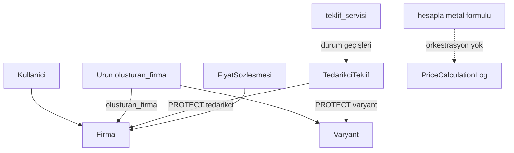

# Mevcut mimari (Faz 3.1 sonrası envanter)

**Tarih:** 2026-11-08  
**Runtime:** Python 3.14.6 · Django 6.1.2 · PostgreSQL  
**Kod kökü:** `Backend/config/`  
**Bağlı ADR:** 0003–0006 (Kabul); 0007 Faz 3a (**Kabul**; 3.1 uygulandı); 0008 Faz 3b (**Taslak**); 0009 admin sertleştirme (**Kabul**; H1–H5 uygulandı)

## Uygulama haritası

| App | Sorumluluk | Servis / selector / komut |
|-----|------------|---------------------------|
| `firmalar` | `Firma`, `Kullanici`, adres, banka, `AuditOlay`, RBAC | `rol_servisi`, `yetki_servisi`, `audit_servisi` (`domain_atomic` / durable), `platform_kurulum`; `selectors/tenant`; komutlar: `bootstrap_platform`, `seed_role_permissions`, `audit_user_assignments` |
| `tanimlar` | Metal, milyem, metal/döviz kuru, fiyat grubu, satış kanalı | admin + `seed_tanimlar` / `seed_fiyat_gruplari`; domain servis yok; kur politikası Faz 3b (ADR-0008) |
| `urunler` | Kategori, `Urun` (`olusturan_firma`, kimlik A/B/C), varyant (`gram_bandi_*`), katalog taşı, onay/eşleştirme | `onay_servisi`, `eslestirme_servisi`, `kategori_servisi` (`kategori_tasi`), `seo_servisi` (teknik fallback), `gram_bandi`; `selectors/katalog_tenant` |
| `fiyatlama` | Sözleşme (K-007/K-008), `TedarikciTeklif` (yaşam döngüsü), teklif taşı, `hesapla()`, `cozumle()`, `PriceCalculationLog` | `teklif_servisi`; `sozlesme_servisi` (`manage_sozlesme`, AKTIF immutability, exclusion); `teklif_eslestirme_uygun_mu`; `fiyat_hesaplama` (saf) |

`AUTH_USER_MODEL = firmalar.Kullanici`. Paket düzeni: ADR-0004 (`models/`, `services/`, `selectors/`, `admin/`, `tests/`).

**Bilinen borç (Faz 3 dışı / sonraki faz):** iki `UrunTasi` modeli (`urunler` vs `fiyatlama`, K-011); `Varyant.stok` ile `TedarikciTeklif.stok_adet` ikiliği (Faz 4 stok üçlüsü).

## HTTP yüzeyi

`config/urls.py` → `admin/`. DRF / public API yok (Faz 7).

## Kimlik ve yetki (Faz 1 / 1.1)

- Kullanıcı: tek `firma` (NOT NULL) + tek `rol`; `save()` → `full_clean()` **tüm kullanıcılar** (superuser muafiyeti yok — ADR-0003).
- İş yetkisi: `has_perm` / `require_perm` + rol grubu matrisi; `is_superuser` tenant/perm kısa yolu **yok**.
- Tenant: `selectors` + admin `get_queryset` / FK scope; `view_all_tenants` yalnız platform + perm.
- Fail audit: `record_audit_durable` (domain_atomic dışı; dış atomic’te sidecar — ADR-0006 O3).

## Katalog (Faz 2 / 2.1)

- Katalog ürünü **platforma** aittir; `Urun.tedarikci` **kaldırıldı** → `olusturan_firma` (alıcıya gösterilmez).
- Onay akışı serviste; tedarikçi `onay_bekliyor` düzenleyemez; `geri_cek` / `taslaga_al`; dört göz onay.
- Kimlik unique: A/B + dolu anahtar + `onay_durumu != reddedildi` (0007).
- Eşleştirme: tedarikçi önerir, platform onaylar; `eslestirme_durumu` boş = fiyat motoru kapısı (ADR-0007); quote ADR-0008.

## Fiyatlama (mevcut — dilim 3.1)

- Teklif durumları: `TASLAK` → `ONAY_BEKLIYOR` → `YAYINDA` ↔ `PASIF`; geçiş yalnız `teklif_servisi`.
- Versiyon: `versiyon` + `onceki_teklif`; onayda eski PASIF → yeni YAYINDA (tek `domain_atomic`).
- Aktif çakışma: aynı tedarikçi+varyant(+kod) için tek `YAYINDA` (partial unique).
- Eşleşme kapısı: `teklif_eslestirme_uygun_mu` — quote ADR-0008.
- Üç teklif modeli: `METAL_BAZLI`, `GRAM_BIRIM`, `SABIT_PARCA`.
- Faz 3 çıktısı proforma; KDV/vergi yok (ADR-0008 §2.9).
- `PriceQuote` / `PricingService` yok; admin’de teklif `durum` salt okunur + action→servis.

## Bilinçli hedef (rapor §10)

Modular monolith; domain service; alıcı fiyatı `PriceQuote` + lock (Faz 3/4); stok üçlüsü Faz 4.

## Bağımlılıklar

`Backend/config/requirements.txt` · `.env` / `.env.example` (secret repoya girmez)
