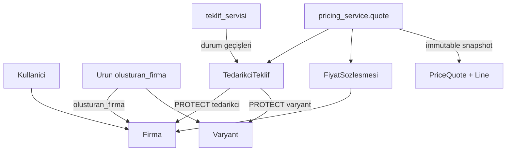

# Mevcut mimari (Faz 3.6 kör havuz / K-011 sonrası envanter)

**Tarih:** 2026-11-08  
**Runtime:** Python 3.14.6 · Django 6.1.2 · PostgreSQL  
**Kod kökü:** `backend/config/`  
**Bağlı ADR:** 0003–0006 (Kabul); 0007 Faz 3a (**Kabul**; 3.1–3.2); 0008 Faz 3b (**Kabul**; Dilim 3.3–3.6 uygulandı); 0009 admin sertleştirme (**Kabul**; H1–H5)

## Uygulama haritası

| App | Sorumluluk | Servis / selector / komut |
|-----|------------|---------------------------|
| `firmalar` | `Firma`, `Kullanici`, adres, banka, `AuditOlay`, RBAC | `rol_servisi`, `yetki_servisi`, `audit_servisi` (`domain_atomic` / durable), `platform_kurulum`; `selectors/tenant`; komutlar: `bootstrap_platform`, `seed_role_permissions`, `audit_user_assignments` |
| `tanimlar` | Metal, milyem, kur sağlayıcı/politika, metal/döviz gözlem, fiyat grubu, satış kanalı (quote TTL) | `kur_servisi`; `currency_conversion` (K-012); admin + `seed_tanimlar` / `seed_fiyat_gruplari` |
| `urunler` | Kategori, `Urun` (`olusturan_firma`, kimlik A/B/C), varyant (`gram_bandi_*`), katalog taşı, onay/eşleştirme | `onay_servisi`, `eslestirme_servisi`, `kategori_servisi` (`kategori_tasi`), `seo_servisi` (teknik fallback), `gram_bandi`; `selectors/katalog_tenant` |
| `fiyatlama` | Sözleşme, teklif, `TeklifTasMaliyeti` (K-011), üç model, `PriceQuote`+Line, `PriceCalculationLog` | `teklif_servisi`; `sozlesme_servisi`; `fiyat_*`; `pricing_service.quote`; `buyer_quote` (B-02) |

`AUTH_USER_MODEL = firmalar.Kullanici`. Paket düzeni: ADR-0004 (`models/`, `services/`, `selectors/`, `admin/`, `tests/`).

**Bilinen borç:** `Varyant.stok` / `TedarikciTeklif.stok_adet` ikiliği (Faz 4). K-011 rename **çözüldü** (`TeklifTasMaliyeti` vs katalog `urunler.UrunTasi`).

## HTTP yüzeyi

`config/urls.py` → `admin/`. DRF / public API yok (Faz 7).

## Kimlik ve yetki (Faz 1 / 1.1)

- Kullanıcı: tek `firma` (NOT NULL) + tek `rol`; `save()` → `full_clean()` **tüm kullanıcılar** (superuser muafiyeti yok — ADR-0003).
- İş yetkisi: `has_perm` / `require_perm` + rol grubu matrisi; `is_superuser` tenant/perm kısa yolu **yok**.
- Tenant: `selectors` + admin `get_queryset` / FK scope; `view_all_tenants` yalnız platform + perm.
- Fail audit: `record_audit_durable` (domain_atomic dışı; dış atomic’te sidecar — ADR-0006 O3).

## Katalog (Faz 2 / 2.1)

- Katalog ürünü **platforma** aittir; `Urun.tedarikci` **kaldırıldı** → `olusturan_firma` (alıcıya gösterilmez).
- Onay akışı serviste; tedarikçi `onay_bekliyor` düzenleyemez; `geri_cek` / `taslaga_al`; dört göz onay.
- Kimlik unique: A/B + dolu anahtar + `onay_durumu != reddedildi` (0007).
- Eşleştirme: tedarikçi önerir, platform onaylar; `eslestirme_durumu` boş = fiyat motoru kapısı (ADR-0007); quote ADR-0008.

## Kur politikası (Dilim 3.3)

- `KurSaglayici`: aynı anda tek `aktif` (partial unique); otomatik fallback yok.
- `KurPolitikasi`: `alici_kur_tipi` ≠ `tedarikci_kur_tipi` (B-05).
- `MetalKuru` / `DovizKuru`: `saglayici`, `kur_tipi`, piyasa `zaman` ≠ `alinma_zamani`; manuel neden + onaylayan.
- Resolve: yalnız aktif sağlayıcı; stale → hata.
- `currency_conversion`: `DovizKuru.kur` = TRY / 1 FX; FX→TRY ×kur, TRY→FX ÷kur; FX→FX TRY pivot; sabit gözlem sessiz yenilenmez.
- `SatisKanali.quote_ttl_saniye`: B-03; değer yoksa veya TTL > kur max gecikme → quote yok.
- B-01 servis payı / B-06 vergi: kodlanmadı.

## Fiyat motoru (Dilim 3.4) + Quote (Dilim 3.5)

- Saf çekirdek: `hesapla_metal_bazli` / `hesapla_gram_birim` / `hesapla_sabit_parca` (+ `hesapla` geriye dönük).
- Yuvarlama: ara adım yok; `toplam_vergisiz` TRY `0.01` HALF_UP.
- `pricing_service.quote`: teklif seçimi (`oncelik`↓ → iç maliyet↑ → `id`↑) + `cozumle` + kur + `PriceQuote`/`Line`.
- İmmutability: model + PostgreSQL UPDATE/DELETE trigger.
- `platform_servis` kalemi yok (B-01). Alıcı sunum: `buyer_quote` (B-02 yalnız toplam; kırılım kapalı).

## Fiyatlama (mevcut — dilim 3.1–3.5)

- Teklif durumları: `TASLAK` → `ONAY_BEKLIYOR` → `YAYINDA` ↔ `PASIF`; geçiş yalnız `teklif_servisi`.
- Versiyon: `versiyon` + `onceki_teklif`; onayda eski PASIF → yeni YAYINDA (tek `domain_atomic`).
- Aktif çakışma: aynı tedarikçi+varyant(+kod) için tek `YAYINDA` (partial unique).
- Eşleşme kapısı: `teklif_eslestirme_uygun_mu`.
- Üç teklif modeli: `METAL_BAZLI`, `GRAM_BIRIM`, `SABIT_PARCA`.
- Faz 3 çıktısı proforma; KDV/vergi yok (ADR-0008 §2.9).
- Admin: teklif `durum` salt okunur + action→servis; `PriceQuote` salt okunur.

## Bilinçli hedef (rapor §10)

Modular monolith; domain service; alıcı fiyatı `PriceQuote` + lock (Faz 4); stok üçlüsü Faz 4.

## Bağımlılıklar

`backend/config/requirements.txt` · `.env` / `.env.example` (secret repoya girmez)
